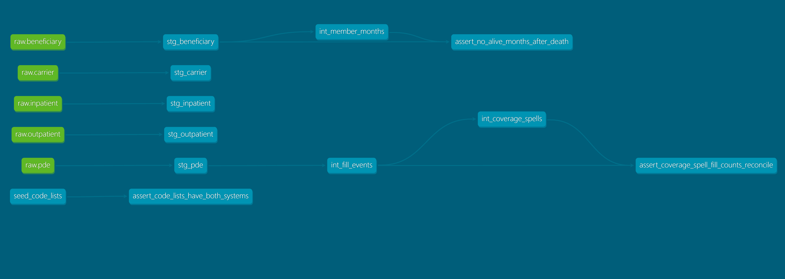
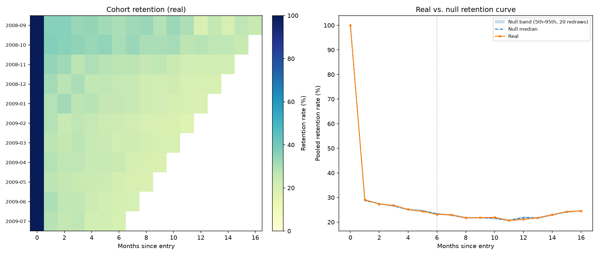

# claims-retention-platform

Treating medication adherence as a retention problem, on three years of
event-level Medicare claims **(CMS DE-SynPUF: 116,352 beneficiaries, ~11 million claim and prescription-fill records)**. Pharmacy claims are an
event stream with the same shape as product telemetry: *fills* instead of
*sessions*, *coverage* instead of *subscriptions*. So, this project builds the
metrics and experimentation layer which product data science would build for a
subscription product, on real(istic) clinical claims.

**v0.5 - warehouse, metrics layer, and fidelity audit complete. Experimentation, causal, and model layers in progress.**

The data is synthetically generated. I didn't just disclaim that, I also
measured it. Every property this project depends on was tested against a
shuffled or redrawn null, and every design choice downstream follows
directly from what passed and what didn't. Where correctness matters
later in the project, estimators are validated against simulations where
the true answer is known. See
[`docs/fidelity_audit.md`](docs/fidelity_audit.md) for the full evidence.

## Headline audit findings

- **Individual drug identity does not survive synthesis.** Only 0.06% of
  (beneficiary, product-code) pairs ever repeat across 5.5M fills, meaning that a
  person's refill sequence for a named drug is essentially randomized
  per claim (Gate 1).
- **Fill timing carries no structure beyond fill count and observation span.** Real and redrawn-null distributions  are statistically indistinguishable on three independent measures (Gate 6, Test 2): a long gap between fills reflects arithmetic, not a real pause.
- **What does survive:** monthly engagement intensity, within-claim cost
  mechanics, and the link between pharmacy activity and chronic-condition
  burden (ρ = 0.24), which are the load-bearing properties the rest of the project
  builds on.
- **The usable analysis window is April 2008 – January 2010.** Claims
  volume declines monotonically through all of 2010, down to ~24% of the
  2009 plateau by December, mking it too early and too steep to be ordinary
  claims-processing lag (Gate 4).

Full writeup, all seven gates, and the terminal-stopping check: [`docs/fidelity_audit.md`](docs/fidelity_audit.md).

## The dual glossary

Pharmacy claims speak two vocabularies: product/tech, and healthcare
industry, and this table is where they're reconciled, along with
whether each metric actually holds up on this specific file.

| What it is | Product / tech name | Healthcare industry name | Where it's computed | Status on DE-SynPUF | Built in |
|---|---|---|---|---|---|
| Share of months with any activity | Monthly active rate, MAU-style engagement | Pharmacy engagement, any-fill month rate | `fct_monthly_active` | ✅ Primary. Interpretable | v0.5 |
| Survival of an entry cohort's activity | Retention curve, cohort retention grid | Persistence curve (activity-based) | `fct_cohort_retention` | ✅ Interpretable as engagement retention | v0.5 |
| Average spend per member per period | ARPU | **PMPM**, Total Cost of Care | `fct_utilization_monthly` | ✅ Interpretable. Within-claim cost mechanics survive | v0.5 |
| Usage per population | Events per user | **HCRU**, admissions per 1,000 | `fct_utilization_monthly` | ✅ Interpretable | v0.5 |
| Share of days covered by supply | Coverage ratio | **PDC**, **MPR** | `fct_pdc_monthly` | ⚠️ Computed; **not interpretable**, days supply is decoupled from fill timing (Gate 6, Test 1) | v0.5 |
| Continuous spell of supply | Subscription period | Treatment episode, coverage spell | `int_coverage_spells` | ⚠️ Computed at any-drug level; drug-level episodes impossible (Gate 1) | v0.5 |
| Time until activity stops | Time-to-churn | Time to treatment discontinuation | `audit/gate7_terminal_stop.py` | ⚠️ Interior gaps ≡ uniform redraw (Gate 6); terminal stopping is real but too rare for a primary target (Gate 7): Module D predicts low engagement instead | v0.5 |
| Pre-existing attributes as controls | User covariates | Comorbidity burden | `stg_beneficiary` | ✅ Real; linked to pharmacy intensity (ρ = 0.24) | v0.5 |
| Predicted disengagement tier | Churn-risk tiering | **Risk stratification** | `models/evaluate.py` | planned | v1.0 |
| Comparing variants on outcomes | A/B test | Comparative effectiveness | `experiments/observational/` | planned | v0.8 |
| Adjusting non-comparable groups | Selection-bias correction | **Confounding adjustment**, propensity methods | `experiments/observational/` | planned | v0.8 |

`fct_engagement_funnel` is descoped. See `FUTURE_WORK.md` for why.

## What's built



13 dbt models (5 staging, 3 intermediate, 5 marts), 70 dbt tests, 1 seed
(versioned ICD-9/ICD-10 code lists). Full lineage and docs via
`make dbt-docs`.



## How to run

```bash
make setup    # venv, deps, pre-commit hooks
make ingest   # load raw CSVs into DuckDB (raw data is downloaded, not committed — see docs/progress-log.md)
make audit    # run every fidelity gate, write reports/figures/ + audit_results.json
make build    # dbt build — staging through marts, all tests
make charts   # regenerate the headline chart
```

## Validation

- **Cross-implementation check.** `fct_cohort_retention`'s real cohort grid
  is independently recomputed in Python (`audit/retention_null.py`) and
  tested to match the dbt mart row-for-row — a difference in washout,
  entry, or censoring logic between the two implementations would show up
  as a mismatch, not silently pass.
- **Determinism suite.** `tests/test_audit_determinism.py` runs every
  gate and every seeded null twice against a 1,000-person fixture and
  asserts identical results. This project has caught and fixed four
  separate reproducibility bugs this way: an unseeded shuffle, an
  unstable sort tiebreak, a dtype-silent cast, and a missing `ORDER BY`
  feeding a seeded RNG, each one a case where code that looked
  deterministic because a seed was fixed turned out not to be, because
  something upstream of it wasn't.

## Roadmap

- **v0.8**: experimentation harness (power/MDE, Type-I
  validation, CUPED, sequential testing) and a plasmode causal-inference
  study on a real hospitalization cohort.
- **v1.0**: calibrated engagement-risk model (LightGBM), SHAP,
  drift monitoring, Dagster asset checks, CI.
- **v1.1 (post-ship)**: Snowflake port, the product-facing report, and a
  claims/EHR phenotype-validation module.

## Limitations

- **The enrollment denominator is strict.** Month-level engagement rates
  are only computed for beneficiaries with a full coverage year, which
  excludes roughly 30% of the June 2009 population that month. Rates are
  therefore read on a more engaged subpopulation and skew high — every
  mart reports both the strict and the all-enrollee denominator so this
  is visible rather than hidden.
- **The clean analysis window is April 2008 – January 2010.** Earlier
  2008 months are under-observed and 2010 declines steadily to ~24% of
  normal volume by December; anything reported as a rate or a level stays
  inside the window, though earlier data is kept wherever a calculation
  needs to look back.
- **PDC is computed but not interpreted.** Proportion of Days Covered is
  built for pipeline completeness and portability, but days-supply is
  decoupled from real fill timing on this file (Gate 6), so it isn't a
  reliable per-person measure here.
- **Terminal stopping is real but rare.** 2.21% of a qualifying population
  had a 180+ day trailing gap before the window closed, about 1.7x the
  chance rate, but too small a share to support a primary "churn"
  prediction target, so Module D targets low engagement instead.
